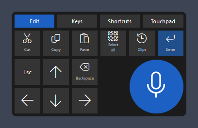
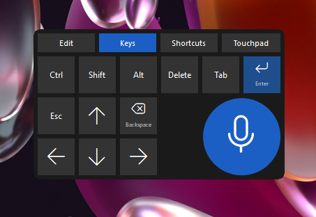
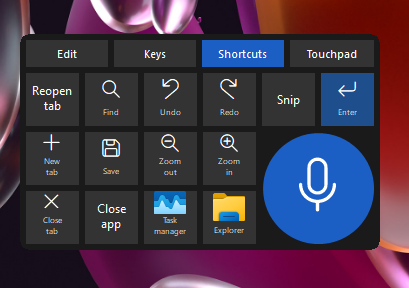
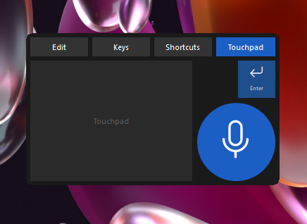
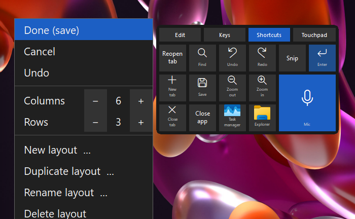

# TouchDock

A floating dock for using a Windows PC from a tablet over Remote Desktop: a dictation mic, a grid of
keys and shortcuts you lay out yourself, and a touchpad, all in one small always-on-top window.

## Why it exists

Working on a Windows PC from an iPad or Android tablet through the Remote Desktop app is fine until you
need Ctrl+C, an arrow key, Backspace held down, a right click, or dictation. The tablet's own keyboard
covers half the screen and has no Ctrl or arrows, and Windows' on-screen touchpad does not open inside a
Remote Desktop session. TouchDock puts those keys, a touchpad and a mic in one dock that stays out of the way
and never takes the focus from the app you are typing in.

## What it does

1. **Mic button.** Tap to start or stop dictation, drag to move the dock. Works with **Windows voice typing**
   (built in, nothing to install) or with **[Handy](https://github.com/cjpais/Handy)** (free, offline,
   installed separately). Win+H follows the same choice.
2. **Keys grid with layouts.** Tabs switch between layouts; the ones included are Edit, Keys, Shortcuts and
   Touchpad. A button can press keys or a key sequence, type a text, open a program, file or web address
   (with its own icon), or hold Ctrl / Shift / Alt for your next key or click. A Ctrl / Shift / Alt button can
   be made sticky: it stays held until you tap it again (on in the Keys layout).
3. **Hold to repeat.** Holding a key such as an arrow or Backspace repeats it like a keyboard, with a key
   click while it repeats.
4. **Touchpad.** Slide to move the pointer, tap to click, two-finger tap or touch and hold to right-click,
   tap then slide to drag. TouchDock draws its own pointer while you use it, because the Remote Desktop app
   hides the pointer in touch mode.
5. **Layout editor.** Drag and drop buttons, tap a free spot to add one from a list (keys, shortcuts,
   Start-menu programs, your own), size buttons from 1 × 1 to 3 × 3, change the grid size, add, copy, rename
   and delete layouts, with Undo and Cancel. Layouts are also a plain text file (`layouts.txt`) you can edit
   or share.
6. **Look.** Size from 50 % to 150 %, opacity from 100 % to 10 %, key sounds on or off.

| Keys | Shortcuts | Touchpad |
|---|---|---|
|  |  |  |

## Requirements

1. Windows 10 or 11.
2. [AutoHotkey v2](https://www.autohotkey.com/) (2.0 or newer), unless you use the ready-made `TouchDock.exe`
   from the Releases page.
3. Optional: [Handy](https://github.com/cjpais/Handy) for offline dictation. Without it, TouchDock uses
   Windows voice typing automatically and hides the Handy menu items.
4. For use from a tablet: the Microsoft Remote Desktop / Windows App on iPad or Android, in **Touch** mode.

## Install and run

1. Install AutoHotkey v2.
2. Download this repository (Code > Download ZIP, or `git clone`) to a folder of your choice.
3. Double-click `touchdock.ahk`. The mic and the grid appear at the bottom right of the screen.
4. Right-click the mic for the menu. "Start with Windows" adds it to your startup programs.
5. Handy is detected automatically. If it is not installed, Windows voice typing is used; install Handy
   later and restart TouchDock to get the Handy items.

## Using it

1. **Mic:** tap to dictate, drag to move. Right-click for the menu.
2. **Tabs:** tap to switch layout; press and slide on a tab to move the dock.
3. **Edit the layouts:** menu > "Edit layout (drag and drop)". Tap Done to save, Cancel to drop the changes.
   The previous layouts file is kept as `layouts.bak`.
4. **By hand:** menu > "Edit layout (text file)". The notes at the top of `layouts.txt` explain every option.
5. **Touchpad speed:** menu > Touchpad speed > Slow / Normal / Fast.
6. **If something looks wrong:** right-click menu or tray icon > Restart TouchDock.

## Known limits

1. Over Remote Desktop, Handy currently loses about half of the audio from the Remote Desktop microphone;
   this has been reported to Handy. Windows voice typing is not affected.
2. Two-finger taps depend on the Remote Desktop app passing both fingers; touch and hold always right-clicks.
3. The pointer TouchDock draws is always a plain arrow (not the text cursor or the hand).

## Files

| File | What it is |
|---|---|
| `touchdock.ahk` | the program: mic, menu, settings |
| `layouts.ahk` | reads and writes `layouts.txt` |
| `grid.ahk` | draws the grid and presses the keys |
| `editor.ahk` | the layout editor |
| `touchpad.ahk` | the touchpad and its pointer |
| `layouts.txt` | the layouts (edit on screen or by hand) |
| `click.wav` | the key click |
| `tests\` | test scripts (see [CONTRIBUTING.md](CONTRIBUTING.md)) |

Your own settings (`touchdock.ini`) and editor backup (`layouts.bak`) are created
next to the program and are not part of the repository.

## Contributing

Contributions are welcome: bug reports, layouts worth sharing, fixes and new button kinds. See
[CONTRIBUTING.md](CONTRIBUTING.md).

## Licence

GNU General Public License v3.0: you may use, change and share TouchDock; if you share a changed version,
share its source under the same licence. See [LICENSE](LICENSE).
